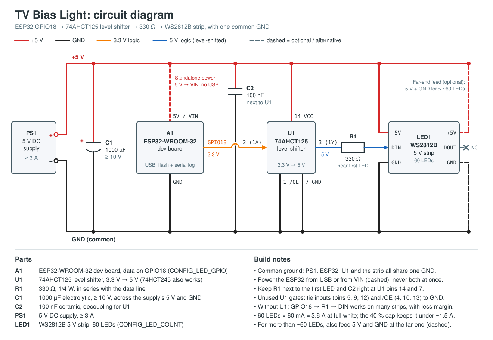

# TV Bias Light: ESP32 firmware

ESP-IDF (v5.x, C) firmware that drives a WS2812B strip behind a TV, controlled from a phone over Wi-Fi, with state kept across power cuts.

| Phase | Status |
|-------|--------|
| 1. Core output (effects, gamma, brightness cap, 60 FPS render task) | Implemented |
| 2. Network control (Wi-Fi STA, REST API, web UI, `tvlight.local`) | Implemented |
| 3. Persistence (debounced NVS save, restore on boot) | Implemented |
| 4. HomeKit (single Lightbulb: on, brightness, hue, saturation) | Implemented |
| 5. Extras (SNTP schedule, UDP ambilight) | Not started |

Developed and compile-tested against ESP-IDF v5.4. Not yet exercised on real hardware (including HomeKit pairing).

## Build, flash, monitor

```sh
git submodule update --init   # Espressif HomeKit SDK (third_party/esp-homekit-sdk)
. $IDF_PATH/export.sh
idf.py set-target esp32          # once
idf.py menuconfig                # "Bias Light: ..." menus: Wi-Fi SSID/password, LED count/GPIO, brightness cap
idf.py build flash monitor
```

Managed components (`led_strip`, `mdns`) are fetched automatically on the first build; versions are pinned by `dependencies.lock`.

Wi-Fi credentials live only in your local, git-ignored `sdkconfig`. Leave the SSID empty and the strip still runs (no network).

## Hardware and wiring



- ESP32-WROOM-32 dev board, WS2812B 5 V strip (about 60-90 LEDs).
- Data: `GPIO18` (`CONFIG_LED_GPIO`) to the strip's DIN.
- Power the strip from its own 5 V supply. **Connect that supply's GND to the ESP32 GND.**
- The ESP32 can run from USB or from the same 5 V rail via its VIN pin (dashed in the diagram), never both at once.
- The ESP32 outputs 3.3 V; WS2812B expects ~0.7 x Vdd = 3.5 V. It often works directly, but a 74AHCT125/74HCT245 level shifter (powered from 5 V, with a 100 nF capacitor across its supply pins) is more reliable.
- Add a ~330 ohm resistor in series with the data line close to the first LED, and a 1000 uF capacitor across the strip's 5 V/GND at the supply.
- Power budget: a WS2812B draws up to ~60 mA at full white, i.e. 3.6 A for 60 LEDs. With the default 40% cap the strip stays under about 1.5 A, so a 5 V / 3 A supply is plenty.
- For more than ~60 LEDs, inject 5 V at both ends of the strip.

## Configuration (menuconfig)

| Option | Default | Meaning |
|--------|---------|---------|
| `CONFIG_LED_COUNT` | 60 | Number of LEDs |
| `CONFIG_LED_GPIO` | 18 | Data pin |
| `CONFIG_MAX_BRIGHTNESS_PCT` | 40 | Hard cap on strip output |
| `CONFIG_RENDER_FPS` | 60 | Render loop rate |
| `CONFIG_DEFAULT_BRIGHTNESS_PCT` | 50 | Brightness when nothing is saved |
| `CONFIG_WIFI_SSID` / `CONFIG_WIFI_PASSWORD` | empty | Station credentials |
| `CONFIG_MDNS_HOSTNAME` | `tvlight` | `http://tvlight.local/` |
| `CONFIG_STORAGE_SAVE_DEBOUNCE_MS` | 5000 | Minimum spacing of NVS writes |
| `CONFIG_HEAP_LOG_INTERVAL_S` | 60 | Free-heap log period |
| `CONFIG_HOMEKIT_ENABLE` | y | Enable the HomeKit accessory |
| `CONFIG_HOMEKIT_SETUP_CODE` | empty | Pairing code `xxx-xx-xxx`; empty = random per device (see below) |
| `CONFIG_HOMEKIT_ACCESSORY_NAME` | `TV Light` | Name in the Home app |

## REST API

`GET /` serves the phone UI (embedded in firmware). `GET /api/state` returns:

```json
{"on":true,"mode":"warm_white","color":[255,147,41],"brightness":50}
```

`POST /api/state` accepts any subset of those fields and returns the new state:

```sh
curl -X POST http://tvlight.local/api/state -d '{"mode":"solid","color":[0,80,255],"brightness":30}'
```

- `mode`: `solid`, `warm_white`, `breathe`, `rainbow`. `color` is used by `solid` and `breathe` only.
- `brightness` is 0-100 and is scaled **onto** 0..`CONFIG_MAX_BRIGHTNESS_PCT`, so 100 means "the cap", never full power.
- Validation: wrong types or unknown modes get HTTP 400; numbers out of range are clamped; bodies over 256 bytes get 413.

## HomeKit (Phase 4)

**Choice: Espressif's [esp-homekit-sdk](https://github.com/espressif/esp-homekit-sdk)** (HAP over Wi-Fi), vendored as a git submodule pinned to a commit and built via `EXTRA_COMPONENT_DIRS`. It pairs directly with the iPhone over the local network and exposes exactly the Lightbulb characteristics requested. esp-matter would also work with Apple Home, but Apple Home requires a hub (HomePod/Apple TV) for Matter accessories, the build is much larger, and the data model is different. The open-source SDK is for development/non-commercial use (the accessory shows as "Uncertified" when adding it).

- One Lightbulb service: On, Brightness (0-100, same scale as the REST API, so still capped), Hue, Saturation. Picking a colour in Home switches `warm_white`/`rainbow`/`solid` to `solid` (`breathe` keeps animating with the new colour). Changes made through the web UI are pushed to Home and vice versa.
- **Pairing code**: there is no default. If `CONFIG_HOMEKIT_SETUP_CODE` is empty, a random valid code and setup ID are generated on first boot using the hardware RNG and stored in NVS. The code is printed in the serial log at every boot (`HomeKit setup code: ...`, plus the `X-HM://` payload). Codes set in menuconfig are rejected (HomeKit disabled, error logged) if malformed or trivial (`000-00-000`, repeated digits, `123-45-678`, `876-54-321`) or if they are the Espressif sample codes (`111-22-333`, `112-23-334`). Note the code is stored unencrypted in NVS (or in the image if set via menuconfig).
- Add it: Home app > Add Accessory > "More options" > pick "TV Light" > enter the code from the serial log ("Add Anyway" for the uncertified prompt).
- To un-pair everything and get a new code: `idf.py erase-flash flash`.
- Remote Siri/Home access away from home needs a Home hub (HomePod / Apple TV).
- `mDNS`: the SDK takes over mDNS initialisation, so `homekit_start()` re-applies the `tvlight.local` hostname and `_http._tcp` service afterwards (`wifi_mgr_mdns_start()`).
- Watchdog: HomeKit pairing does a CPU-heavy SRP exchange, so the idle-task check on core 0 is disabled in `sdkconfig.defaults`. The render task stays subscribed to the task watchdog.

Host-side unit tests for the pure helpers (code validation/generation, HSV conversion):

```sh
gcc -Wall -Icomponents/homekit/include test_host/test_hk_util.c components/homekit/hk_util.c -lm -o /tmp/t && /tmp/t
```

## Design notes

- **Render loop**: one FreeRTOS task pinned to core 1 (Wi-Fi runs on core 0) at ~60 FPS. Per-pixel work is integer only; the gamma (2.2) and breathe tables are built once at start-up. Brightness changes and on/off fade over ~100 ms instead of popping. Unchanged frames are not re-sent (except a 1 s keep-alive), which reduces flicker risk from Wi-Fi interrupts. The only wait is the RMT transfer inside `led_strip_refresh` (~2 ms for 60 LEDs).
- **Gamma and cap order**: colour -> gamma -> multiply by (brightness x cap). The cap therefore limits linear light output and cannot be exceeded by any API input.
- **Persistence**: `on`, `mode`, `color`, `brightness` are stored as one versioned NVS blob. Changes are coalesced by a writer task and written at most once per `CONFIG_STORAGE_SAVE_DEBOUNCE_MS`; identical state is never rewritten. A change made within the last few seconds before a power cut can be lost.
- **Watchdog**: the task watchdog is enabled with panic-on-timeout (5 s) and the render task is subscribed; any crash or hang reboots into the last saved state.
- **Heap**: free/min-free/largest-block heap is logged every `CONFIG_HEAP_LOG_INTERVAL_S` seconds (tag `main`) for soak testing. The HTTP path frees all per-request allocations.
- **Partition table**: `partitions.csv` has a 64 KB NVS (HomeKit pairings + state) and two 1.75 MB OTA slots for a future OTA feature (4 MB flash assumed).

## Assumptions and deviations

- GPIO 18, 60 LEDs, 40% cap, 4 MB flash were assumed per the Kconfig defaults.
- Brightness API unit is 0-100 within the cap range (see above).
- `esp-homekit-sdk` (git submodule, pinned) and its registry dependencies (`libsodium`, `json_parser`, `json_generator`) were added for Phase 4, as approved.
- `espressif/mdns` was added as a managed component because ESP-IDF 5.x no longer bundles it; it is required for `tvlight.local`.
- Stretch goals not implemented yet: SoftAP captive-portal fallback (the strip keeps retrying the station connection with back-off), OTA update endpoint.

## Project layout

```
main/                 app_main, heap monitor
components/homekit/   HomeKit Lightbulb, setup code handling
third_party/esp-homekit-sdk/  Espressif HomeKit SDK (submodule)
test_host/            host-side unit tests
docs/                 circuit diagram (SVG)
components/effects/   strip output, effects, gamma, state, render task
components/wifi_mgr/  Wi-Fi station + mDNS
components/http_api/  REST API + embedded index.html
components/storage/   debounced NVS persistence
```
